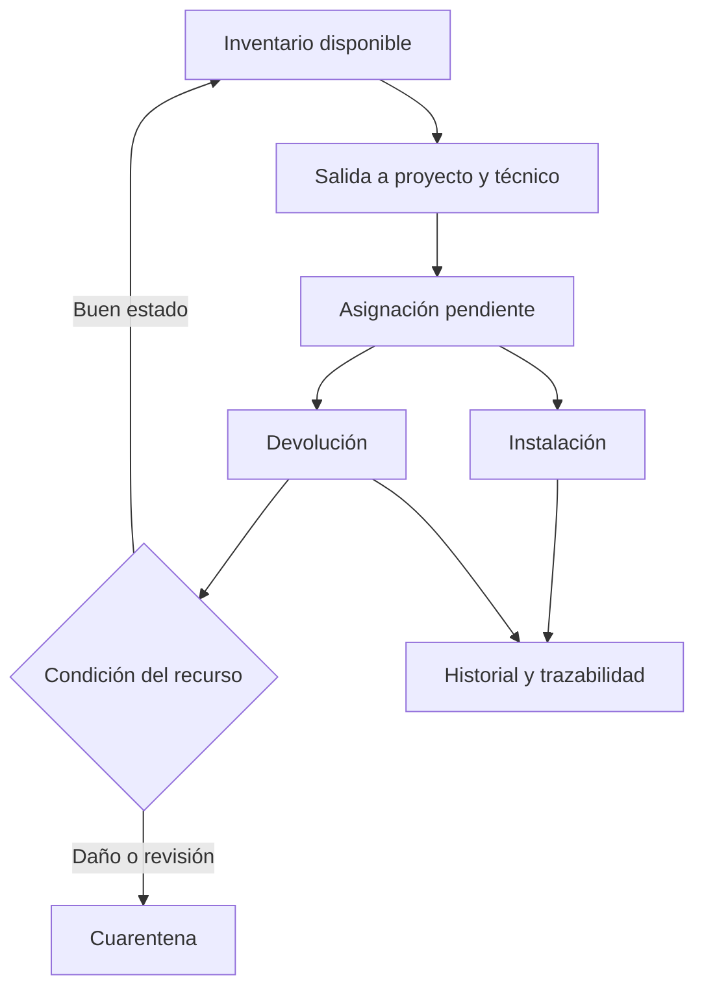

# 📦 STOCKROOM

### Gestión y trazabilidad de inventario para Grupo Dtech

**Proyecto de cátedra · Diseño y Programación de Software Multiplataforma**

**[🌐 Aplicación web](https://github.com/j0su22/dps941-stockroom-web)** &nbsp; · &nbsp; **[📱 Aplicación móvil](https://github.com/j0su22/dps941-stockroom-mobile)**

---

## 🎓 Presentación académica

| Información | Detalle |
| :--- | :--- |
| **Estudiante** | Josue David Cortez Aguilar |
| **Carné** | CA242249 |
| **Asignatura** | Diseño y Programación de Software Multiplataforma |
| **Código** | DPS941 |
| **Proyecto** | Stockroom |
| **Organización de referencia** | Grupo Dtech |

## 💡 ¿Qué es Stockroom?

Stockroom es una solución multiplataforma orientada al control de equipos y materiales utilizados en proyectos técnicos. Su propósito es facilitar la consulta de existencias, la identificación de responsables y el seguimiento de los recursos desde su salida de bodega hasta su instalación o devolución.

La solución se organiza en una **aplicación web para la gestión administrativa** y una **aplicación móvil para la operación en campo**.

> **Este repositorio es el punto de entrada a la entrega.** Centraliza la presentación y los enlaces de consulta. El código fuente y las instrucciones técnicas se mantienen en los repositorios de cada aplicación.

## 🔎 Problema que aborda

El seguimiento disperso de equipos y materiales dificulta responder preguntas fundamentales de la operación:

- ¿Cuántas unidades están disponibles en bodega?
- ¿Qué recursos se entregaron a un proyecto y quién es responsable?
- ¿Qué unidades ya fueron instaladas y cuáles siguen pendientes?
- ¿Qué materiales fueron devueltos y en qué condiciones?
- ¿Cómo consultar el historial de un equipo o detectar existencias bajas?

Stockroom reúne estos procesos alrededor de inventario, proyectos, asignaciones y movimientos, manteniendo la trazabilidad de los recursos.

## 🗂️ Repositorios de la solución

| Plataforma | Propósito | Código e instrucciones |
| :--- | :--- | :--- |
| **🌐 Web** | Gestión de inventario, movimientos, proyectos, usuarios y reportes. | **[dps941-stockroom-web](https://github.com/j0su22/dps941-stockroom-web)** |
| **📱 Móvil** | Consulta y reconocimiento de equipos, operación de campo, instalaciones, devoluciones e historial. | **[dps941-stockroom-mobile](https://github.com/j0su22/dps941-stockroom-mobile)** |
| **📘 Presentación** | Portada académica y acceso centralizado a las dos aplicaciones. | **[dps941-stockroom](https://github.com/j0su22/dps941-stockroom)** |

## 🧭 Guía de revisión para el docente

| Paso | Qué consultar | Acceso |
| :---: | :--- | :--- |
| **1** | Descripción, alcance y organización de la solución. | Este documento. |
| **2** | Aplicación web, estructura e instrucciones de ejecución. | [README web](https://github.com/j0su22/dps941-stockroom-web#readme) |
| **3** | Aplicación móvil, configuración e instrucciones de ejecución. | [README móvil](https://github.com/j0su22/dps941-stockroom-mobile#readme) |
| **4** | Implementación de pantallas, servicios y lógica de negocio. | [Código web](https://github.com/j0su22/dps941-stockroom-web/tree/main/src) · [Código móvil](https://github.com/j0su22/dps941-stockroom-mobile/tree/main/src) |
| **5** | Documentación técnica y pruebas disponibles. | Consultar el contenido de cada repositorio. |
| **6** | Evolución y aportes registrados en el control de versiones. | [Commits web](https://github.com/j0su22/dps941-stockroom-web/commits/main/) · [Commits móvil](https://github.com/j0su22/dps941-stockroom-mobile/commits/main/) |

## ⚙️ Áreas funcionales

| Área | Finalidad |
| :--- | :--- |
| **Inventario** | Identificar equipos serializados y consumibles, consultar disponibilidad, ubicación y estado. |
| **Movimientos y trazabilidad** | Registrar operaciones y consultar su historial, cantidades y responsables. |
| **Proyectos y asignaciones** | Relacionar recursos con proyectos y personal técnico. |
| **Instalaciones y devoluciones** | Dar seguimiento a las unidades entregadas y diferenciar instalación, devolución y cuarentena. |
| **Alertas y reportes** | Apoyar el seguimiento de existencias y el análisis de la operación. |
| **Usuarios y acceso** | Diferenciar las responsabilidades de administración, bodega y personal técnico. |

## 👥 Roles de usuario

| Rol | Responsabilidad dentro de la solución |
| :--- | :--- |
| **Administración** | Supervisar recursos, proyectos, usuarios y resultados de la operación. |
| **Bodega** | Gestionar existencias y movimientos de equipos y materiales. |
| **Técnico** | Consultar sus asignaciones y registrar actividades de campo. |

Los permisos y su implementación se documentan en cada aplicación. La disponibilidad de una opción en pantalla no sustituye la validación de autorización en la capa de datos.

## 🔄 Flujo operativo

**Reglas de negocio centrales:** una salida reduce la disponibilidad; una instalación no vuelve a descontar las unidades ya entregadas; una devolución en buen estado repone existencias, mientras que una devolución dañada o en revisión se mantiene fuera del stock disponible.

## 🛠️ Tecnologías y organización

| Componente | Tecnología |
| :--- | :--- |
| **Interfaz web** | React, Next.js y TypeScript |
| **Interfaz móvil** | React Native, Expo y TypeScript |
| **Autenticación de la integración** | Firebase Authentication |
| **Persistencia compartida de la integración** | Cloud Firestore |
| **Diseño de referencia** | Figma |
| **Control de versiones** | Git y GitHub |

La organización del proyecto distingue **interfaz de usuario**, **lógica de negocio** y **acceso a datos**. Los detalles de configuración, dependencias, ejecución, pruebas y despliegue pertenecen a los README de cada plataforma.

> **Alcance de esta portada:** describe la solución y orienta su revisión. El estado de implementación, los resultados de pruebas y los enlaces de despliegue deben consultarse en la versión publicada de cada repositorio.

---

**STOCKROOM · Grupo Dtech**  
Proyecto académico de Diseño y Programación de Software Multiplataforma

**Josue David Cortez Aguilar · CA242249**

[🌐 Revisar web](https://github.com/j0su22/dps941-stockroom-web) &nbsp; · &nbsp; [📱 Revisar móvil](https://github.com/j0su22/dps941-stockroom-mobile)

